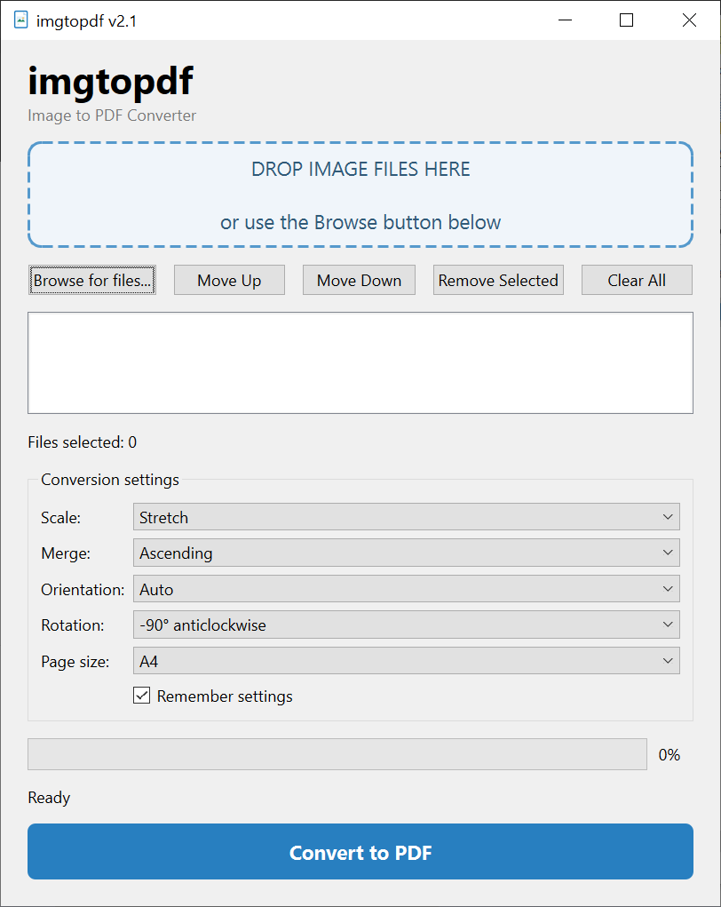

# imgtopdf v2.1

### A simple, lightweight Windows image-to-PDF converter

imgtopdf is a free Windows application that makes converting images into PDF documents quick and straightforward.

Convert individual images into separate PDF files, or combine multiple images into a single PDF. Arrange images in your preferred order, rotate them, select your page size and choose how they fit on the page.

Built with Python, PySide6, img2pdf and pypdf, and the help of ChatGPT.

---

## Features

- **Simple interface** – add images using Browse or drag-and-drop.
- **Individual PDFs** – create a separate PDF for every image.
- **Combined PDFs** – merge multiple images into one PDF.
- **Natural sorting** – arrange files in ascending or descending order.
- **Custom ordering** – drag and drop images into your preferred sequence.
- **Move Up / Move Down** – adjust the order of selected images.
- **Image rotation** – 90° clockwise, 90° anticlockwise or 180°.
- **Flexible scaling** – None, Stretch or Fit.
- **Page orientation** – Auto, Portrait or Landscape.
- **Multiple paper sizes** – A1 through A7 and US Letter.
- **Image formats** – JPEG, PNG, BMP, TIFF and WebP.
- **Transparency support** – transparent images are composited onto a white background.
- **Remember settings** – optionally save conversion preferences between sessions.
- **Output folder access** – conveniently open the folder containing generated PDFs.
- **Overwrite protection** – existing PDF files are never silently overwritten.

---

## Download

The latest Windows executable is available from the [Releases](../../releases) section.

Download `imgtopdf.exe` and run it. Python does not need to be installed.

---

## Using imgtopdf

1. Add images using the Browse button or drag images into the drop area.
2. Arrange the images if required.
3. Select your conversion settings.
4. Click **Convert to PDF**.
5. Open the output folder directly from the completion dialog.

### Merge options

| Option | Behaviour |
|---|---|
| None | Creates individual PDFs |
| Ascending | Combines images in natural ascending order |
| Descending | Combines images in natural descending order |
| Custom | Combines images in the displayed order |

### Scaling options

| Option | Behaviour |
|---|---|
| None | Retains the original image dimensions |
| Stretch | Fills the entire PDF page |
| Fit | Fits the image to the page while preserving its aspect ratio |

### Rotation

Images can be rotated before being placed on the PDF page:

- None
- 90° clockwise
- 90° anticlockwise
- 180°

### Remember settings

Remember settings is optional. When enabled, imgtopdf saves your conversion preferences and last-used browsing directory for the next session. When checked a small .ini file is created in your user appdata, if you clear the checkbox this is deleted.

Selected image files are never remembered.

---

## Supported image formats

- JPEG / JPG / JFIF
- PNG
- BMP
- TIFF / TIF
- WebP

Transparent PNG and WebP images are supported. Transparent areas are converted to white in the resulting PDF.

---

## Running from Python

To run imgtopdf from source, install Python and the required dependencies.

Install the dependencies:

```bash
pip install -r requirements.txt
```

Run the application:

```bash
python imgtopdf.py
```

### Building the Windows executable

The application can be packaged using PyInstaller:

```bash
pyinstaller --onefile --windowed --icon=imgtopdf.ico --add-data "imgtopdf.ico;." imgtopdf.py
```

### Automated build (Windows)

For convenience, a Windows build script is included. Simply double-click:

```
build.bat
```

The script automatically:

- Creates a virtual environment.
- Installs the required dependencies.
- Generates the application icon.
- Builds the standalone executable.

Once completed, the executable can be found at:

```
dist\imgtopdf.exe
```

No manual PyInstaller commands are necessary.

---

## Technology

imgtopdf is developed using:

- Python
- PySide6
- img2pdf
- pypdf
- Pillow
- natsort

---

## Version

**Current version: 2.1**

---

## Screenshot



## Licence

See the repository licence file for licensing terms.
